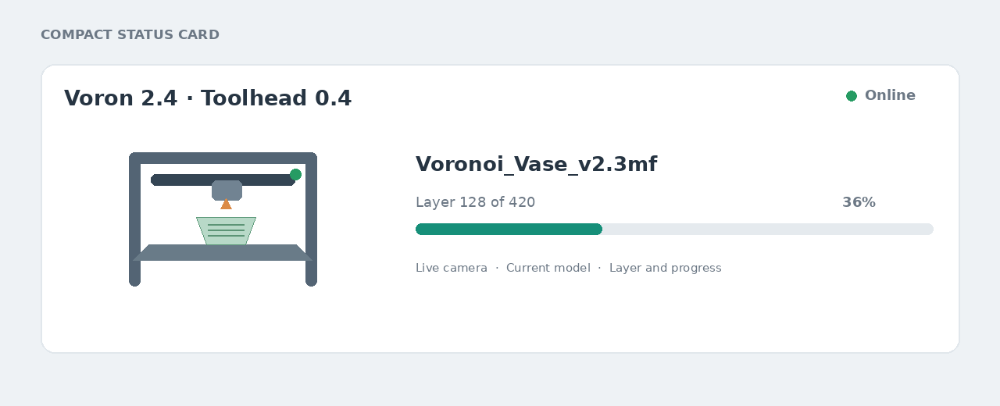
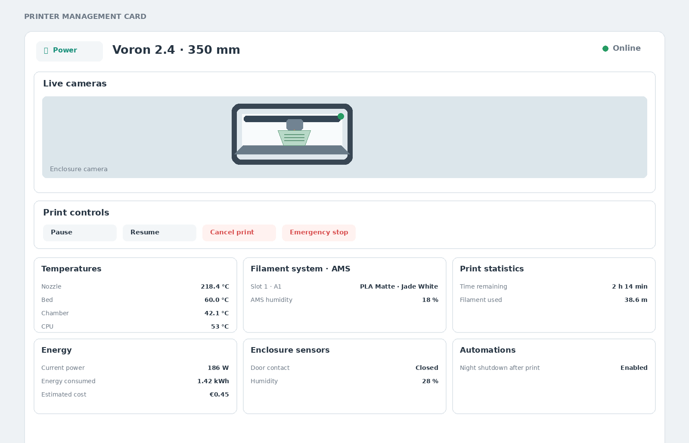

# HA 3Dprinter Card


Dwie karty Lovelace dla Home Assistant:

- **`custom:ha-3dprinter-card-mini`** — kompaktowy podgląd drukarki: nazwa, status online/offline, kamera, model, warstwa i postęp. Po utracie połączenia pokazuje wybrany obraz drukarki.
- **`custom:ha-3dprinter-card`** — karta zarządzająca z konfigurowalnymi sekcjami, kamerami, przyciskami, temperaturami, AMS, statystykami, energią, Spoolmanem, listą wydruków i przełącznikami automatyzacji.

## Podgląd

Poniższe ilustracje pokazują układ kart na przykładowych danych:





Karty nie wymagają dodatkowej integracji ani bibliotek JavaScript. Dane są pobierane z encji Home Assistant, a działania wykonywane przez standardowe usługi HA. Dzięki temu obsługują Moonraker, OctoPrint i inne integracje, o ile udostępniają odpowiednie encje lub usługi. Nie ma automatycznego wykrywania nazw encji ani tłumaczenia specyficznych usług drukarki — mapowanie wykonuje się w edytorze karty.

## Instalacja przez Home Assistant Marketplace / HACS

**Home Assistant 2026.11 i nowszy (Marketplace):**

1. Utwórz publiczne repozytorium GitHub o nazwie `ha-3dprinter-card` i prześlij do niego zawartość tego projektu.
2. W Home Assistant otwórz **Ustawienia → Marketplace** i wybierz **Add from link**.
3. Wklej pełny adres repozytorium GitHub lub `właściciel/ha-3dprinter-card`, dodaj repozytorium, otwórz jego stronę i wybierz instalację.
4. Odśwież frontend Home Assistant. Marketplace powinien dodać zasób karty automatycznie.

**Starszy HACS (Home Assistant przed 2026.11):**

1. Otwórz **HACS → Frontend / Dashboard**.
2. Wybierz **Custom repositories** i dodaj publiczny adres repozytorium jako kategorię **Dashboard**.
3. Zainstaluj **HA 3Dprinter Card** i odśwież przeglądarkę.

Przy ręcznym dodawaniu zasobu użyj ścieżki zgodnej z instalatorem:

- Marketplace: `/local/community/ha-3dprinter-card/ha-3dprinter-card.js`
- Starszy HACS: `/hacsfiles/ha-3dprinter-card/ha-3dprinter-card.js`

Typ zasobu: `module`. Przy ręcznej instalacji skopiuj `ha-3dprinter-card.js` do `/config/www/` i dodaj zasób `/local/ha-3dprinter-card.js`.

> Repozytorium zawiera `hacs.json`, ikonę oraz podglądy kart. Aby pojawić się w katalogu społeczności Marketplace, publiczne repozytorium musi dodatkowo mieć opis, tematy GitHub, włączone Issues i wydanie GitHub; samo utworzenie repozytorium nie publikuje go automatycznie w katalogu. Szczegóły w sekcji „Publikacja na GitHub”.

## Karta mini

Przykład konfiguracji YAML:

```yaml
type: custom:ha-3dprinter-card-mini
name: Bambu Lab A1 mini
language: auto
status_entity: binary_sensor.printer_online
power_entity: switch.printer_power
power_button_position: none
offline_image: a1mini
camera_entity: camera.printer
model_entity: sensor.printer_current_filename
layer_entity: sensor.printer_current_layer
total_layers_entity: sensor.printer_total_layers
progress_entity: sensor.printer_print_progress
show_camera: true
show_model: true
show_layer: true
show_progress: true
camera_refresh: 20
```

Wszystkie pola prezentacji (`show_camera`, `show_model`, `show_layer`, `show_progress`) można niezależnie wyłączyć. Nazwa drukarki i status pozostają widoczne. `status_entity` powinien zwracać stan typu `on/off`, `online/offline` lub inny stan z listy `online_states`.

## Karta zarządzająca

Przykład większej karty. Nazwy encji i usług są przykładowe — należy je dopasować do zainstalowanej integracji:

```yaml
type: custom:ha-3dprinter-card
name: Voron 2.4
language: pl
theme: ""
status_entity: binary_sensor.voron_online
power_entity: switch.voron_power
power_button_position: left
confirm_power_off: true
offline_image: enclosed
camera_refresh: 15
sections:
  - id: cameras
    type: cameras
    title: Kamery
    enabled: true
    wide: true
    items:
      - label: Komora
        entity: camera.voron_chamber
      - label: Dysza
        entity: camera.voron_nozzle

  - id: controls
    type: controls
    title: Sterowanie drukiem
    enabled: true
    wide: true
    items:
      - label: Pauza
        action: preset
        command: pause
        service: script.turn_on
        entity: script.voron_pause
      - label: Wznów
        action: preset
        command: resume
        service: script.turn_on
        entity: script.voron_resume
      - label: Anuluj wydruk
        action: preset
        command: cancel
        service: script.turn_on
        entity: script.voron_cancel
        dangerous: true
      - label: Emergency stop
        action: preset
        command: emergency
        service: script.turn_on
        entity: script.voron_emergency_stop
        dangerous: true
      - label: Fluidd
        action: url
        url: http://voron.local

  - id: temperatures
    type: temperatures
    title: Temperatury
    enabled: true
    items:
      - label: Dysza
        entity: sensor.voron_extruder_temperature
      - label: Stół
        entity: sensor.voron_bed_temperature
      - label: Komora
        entity: sensor.voron_chamber_temperature
      - label: CPU
        entity: sensor.voron_cpu_temperature

  - id: ams
    type: ams
    title: Filament / AMS
    enabled: true
    items:
      - label: Slot 1
        entity: sensor.ams_slot_1_filament
      - label: Wilgotność AMS
        entity: sensor.ams_humidity

  - id: statistics
    type: statistics
    title: Statystyki
    enabled: true
    items:
      - label: Status wydruku
        entity: sensor.voron_print_state
      - label: Pozostały czas
        entity: sensor.voron_time_remaining
      - label: Zużyty filament
        entity: sensor.voron_filament_used

  - id: energy
    type: energy
    title: Energia
    enabled: true
    energy_entity: sensor.voron_energy_total
    price_per_kwh: 0.32
    currency: EUR
    items:
      - label: Aktualna moc
        entity: sensor.voron_power

  - id: spoolman
    type: spoolman
    title: Spoolman
    enabled: true
    url: http://spoolman.local
    items:
      - label: Pozostały filament
        entity: sensor.spoolman_remaining_filament

  - id: sensors
    type: sensors
    title: Czujniki komory
    enabled: true
    items:
      - label: Drzwi komory
        entity: binary_sensor.voron_door
      - label: Wilgotność
        entity: sensor.voron_chamber_humidity

  - id: automations
    type: automations
    title: Automatyzacje
    enabled: true
    items:
      - label: Wyłącz po zakończeniu w nocy
        entity: automation.voron_power_off_after_night_print

  - id: todo
    type: todo
    title: Kolejka modeli
    enabled: true
    entity: todo.print_queue
```

## Edytor wizualny

Edytor karty pozwala skonfigurować nazwę, język, motyw, status, zasilanie, pozycję przycisku, obraz offline i — w karcie mini — encje oraz widoczność każdego elementu.

W karcie zarządzającej sekcje można włączać/wyłączać, zmieniać ich kolejność, wybierać typ i szerokość oraz dodawać/usuwać wiersze i przyciski. Każdy wiersz i przycisk można również niezależnie ukryć lub pokazać. Sekcja jest wyświetlana tylko wtedy, gdy jest włączona i zawiera dane. Duża karta ma domyślnie szerokość 12/12 kolumn w widoku Sections, ale można ją zmniejszyć do minimum 6/12; mini karta startuje jako 6/12 i może zostać zmniejszona do 3/12. Sekcje `Cameras`, `Controls` i `Print queue` są domyślnie szerokie; pozostałe układają się responsywnie i mogą być wymuszone na pełną szerokość opcją `Full width`.

Typy sekcji:

| Typ | Zastosowanie |
|---|---|
| `cameras` | Jedna lub więcej encji `camera.*` |
| `controls` | Przyciski: przełączenie encji, wywołanie usługi lub otwarcie URL |
| `temperatures` | Temperatury dyszy, stołu, komory, CPU itd. |
| `ams` | Dane AMS / MMU / innych systemów filamentowych |
| `statistics` | Czas, status, filament, warstwy i inne statystyki |
| `energy` | Zużycie w kWh, moc i szacunkowy koszt z ceny za kWh |
| `spoolman` | Encje Spoolman i link do interfejsu Spoolman |
| `sensors` | Dowolne encje, np. kontaktrony, wilgotność, temperatura suszarki |
| `automations` | Przełączniki encji automatyzacji |
| `todo` | Lista zadań Home Assistant (`todo.*`) z dodawaniem, kończeniem i usuwaniem pozycji |
| `custom` | Dowolna lista encji / wartości |

### Przyciski i usługi

Dla przycisków dostępne są trzy tryby:

- `toggle` — włącza/wyłącza wskazaną encję domeny obsługującej `turn_on` / `turn_off`.
- `service` — wywołuje usługę `domain.service`; opcjonalnie można podać encję i dane usługi w JSON.
- `url` — otwiera adres HTTP(S) w nowej karcie.

Dodatkowo `preset` wyświetla przetłumaczoną etykietę `Pause`, `Resume`, `Cancel` lub `Emergency stop`, ale nadal wymaga wskazania usługi właściwej dla integracji (albo skryptu HA). Dzięki temu karta nie zakłada, że Moonraker, OctoPrint i inne integracje używają tych samych nazw usług. Przyciski oznaczone `dangerous: true` są wyróżniane kolorem ostrzegawczym; dla nich można także włączyć potwierdzenie przez `confirm: true`.

Przykładowo można utworzyć skrypty HA dla pauzy/wznowienia/anulowania, a następnie wskazać usługę `script.turn_on` i encję `script.*`.

### Lista wydruków

Sekcja `todo` korzysta z natywnej integracji Home Assistant To-do i jej usług (`todo.get_items`, `todo.add_item`, `todo.update_item`, `todo.remove_item`). Wymaga encji `todo.*`. Nie zapisuje zadań w pamięci przeglądarki.

### Motywy i języki

- `language: auto` korzysta z języka interfejsu HA. Można też wybrać `en`, `pl`, `de`, `es`, `fr`, `pt`, `ar`, `hi`, `zh` lub `ja`.
- Karta używa zmiennych CSS Home Assistant. Pole `theme` pozwala wskazać nazwę motywu zainstalowanego w HA i zastosować jego zmienne lokalnie dla tej karty. Puste pole oznacza motyw aktualnie aktywny na pulpicie.
- Własne tytuły sekcji, etykiety encji i etykiety przycisków są treścią wpisaną przez użytkownika i nie są automatycznie tłumaczone. Stałe etykiety interfejsu są dostępne w 10 językach: angielskim, polskim, niemieckim, hiszpańskim, francuskim, portugalskim, arabskim, hindi, chińskim i japońskim.

### Obraz drukarki offline

Dostępne warianty wbudowane: ramowa drukarka typu Ender 3 V3, Bambu Lab A1 mini i drukarka komorowa. Można wgrać plik SVG (do 512 KB) albo wkleić własny dokument SVG. SVG jest oczyszczany z elementów wykonywalnych i zewnętrznych odwołań przed użyciem.

## Konfiguracja encji — wskazówki

Nie istnieje uniwersalny zestaw encji dla wszystkich producentów i integracji. Wybierz encje w edytorze lub wpisz ich identyfikatory w YAML:

- **Status**: najlepiej `binary_sensor` online/offline. Można też użyć encji tekstowej i ustawić `online_states` na rozdzieloną przecinkami listę stanów oznaczających dostępność.
- **Zasilanie**: encja HA obsługująca `turn_on` i `turn_off`, np. `switch.*`, `input_boolean.*` albo odpowiedni przełącznik inteligentnego gniazdka.
- **Temperatury i statystyki**: dowolne encje stanu. Atrybut opcjonalny pozwala odczytać wartość z atrybutu zamiast ze stanu głównego.
- **Energia**: `energy_entity` musi zwracać wartość w kWh; karta mnoży ją przez `price_per_kwh`. Nie wykonuje konwersji Wh → kWh ani nie oblicza taryf dynamicznych.
- **Todo**: wymaga standardowej encji `todo.*` obsługującej usługi Home Assistant To-do.

## Pliki repozytorium

- `ha-3dprinter-card.js` — samodzielny bundle obu kart i edytora.
- `hacs.json` — manifest HACS.
- `icon.svg`, `icon.png` — ikona repozytorium.
- `examples/` — przykładowe konfiguracje Lovelace.

## Publikacja na GitHub

Repozytorium powinno mieć dokładną nazwę `ha-3dprinter-card` — plik JavaScript i `hacs.json` są już do niej dopasowane. Po przesłaniu plików:

1. Ustaw opis repozytorium, np. `Configurable Home Assistant Lovelace cards for 3D printers`.
2. Dodaj tematy: `home-assistant`, `home-assistant-card`, `lovelace`, `3d-printer`, `3d-printing`, `moonraker`, `octoprint`.
3. Pozostaw włączone GitHub Issues.
4. Utwórz wydanie GitHub z tagiem `v1.0.0`.
5. Pozytywny wynik workflow **Validate** potwierdzi walidację repozytorium przez HACS. Katalog społeczności ma osobny proces przyjęcia repozytorium; repozytorium dodane ręcznie z linku można instalować wcześniej.

Pliki `icon.png` i `icon.svg` zapewniają identyfikację projektu, a `icon.png` jest widoczna w README. Dla kart typu Dashboard Marketplace prezentuje obrazy z README; manifest `hacs.json` nie udostępnia osobnego pola `icon` dla tego typu projektu, więc nie można wymusić osobnej ikony w wierszu katalogu samym plikiem manifestu.

## Wersja i ograniczenia

Wersja `1.0.0`. To karta frontendowa, nie integracja urządzenia: nie tworzy encji drukarki, nie konfiguruje Moonrakera/OctoPrinta, nie skanuje automatycznie usług i nie wymusza konkretnego firmware. Zmiany statusu, wartości sensorów i atrybutów są odświeżane wraz ze standardowymi aktualizacjami Home Assistant; obraz kamer jest odświeżany zgodnie z `camera_refresh`.

Zgłoszenia problemów powinny zawierać wersję Home Assistant, integrację drukarki, przykładowe identyfikatory encji oraz fragment konfiguracji karty (bez tokenów i danych dostępowych).
